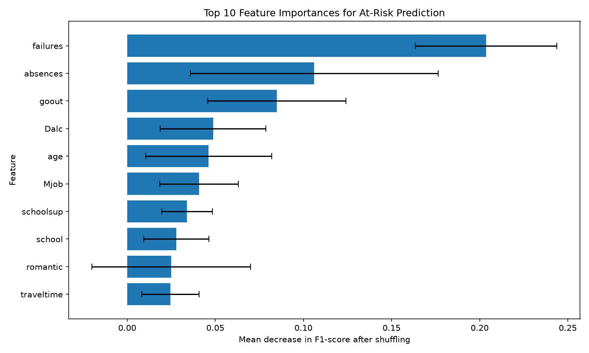

# Student Success Predictor

Student Success Predictor is a machine learning project that estimates whether
a secondary-school student may be at risk of failing Mathematics. It combines
an exploratory data script, model comparison and feature-importance analysis,
and a Streamlit application for trying individual student profiles.

## Project goal

The project explores whether information about a student's background, family,
school support, and lifestyle can help identify students who might benefit from
additional academic support. The predictions are estimates, not judgments about
individual students.

## Technologies

- **Python** for the project code
- **pandas** for loading and preparing tabular data
- **scikit-learn** for preprocessing, model training, validation, and evaluation
- **Matplotlib** for the feature-importance chart
- **Streamlit** for the interactive web application

## Dataset and target

The project uses the Mathematics course file from the [UCI Student Performance
dataset](https://archive.ics.uci.edu/dataset/320/student+performance). The
Mathematics dataset contains **395 records** and **33 original columns**.
It is loaded as a semicolon-separated file from `data/student-mat.csv`.

Academic risk is defined from the final grade:

- `at_risk = 1` when `G3 < 10` out of 20
- `at_risk = 0` when `G3 >= 10`

The input features exclude `G1`, `G2`, and `G3`, so the model does not use
period or final grades to predict risk.

## Preprocessing and evaluation

Categorical features are one-hot encoded with unknown categories ignored, and
numeric features are standardized. These transformations are included in a
scikit-learn `Pipeline` so they are fitted as part of training rather than
before the data split.

The data is divided into an **80/20 stratified train/test split** with
`random_state=42`. Stratification maintains the at-risk class proportions in
both sets. Model comparison uses **5-fold `StratifiedKFold` cross-validation**
on the training set. The held-out test set is reserved for the final evaluation.

`train_model.py` compares Logistic Regression, Random Forest,
HistGradientBoosting, and a most-frequent-class `DummyClassifier` baseline.
The best non-dummy model is selected by mean cross-validation F1-score for the
at-risk class. HistGradientBoosting was selected because it had the highest
cross-validation F1-score among the three machine learning models:

| Model | Cross-validation at-risk F1 |
|---|---:|
| Logistic Regression | 0.401 |
| Random Forest | 0.303 |
| HistGradientBoosting | **0.459** |
| DummyClassifier | 0.000 |

## Test-set results

The selected HistGradientBoosting model achieved the following results on the
held-out test set:

| Metric | Result |
|---|---:|
| Accuracy | 73.4% |
| Precision (at-risk class) | 63.2% |
| Recall (at-risk class) | 46.2% |
| F1-score (at-risk class) | 53.3% |

It correctly identified **12 of 26 at-risk students** and missed **14**.

## Feature importance

`feature_importance.py` calculates permutation importance on the held-out test
set using F1-score. Previous class failures (`failures`) and absences
(`absences`) were the two highest-ranked features in that analysis.



Permutation importance measures predictive usefulness, not causation. A feature
ranking does not show that a feature causes academic outcomes.

## Setup and run

Create and activate a virtual environment, then install the project
dependencies:

```bash
python -m venv .venv
```

On macOS or Linux:

```bash
source .venv/bin/activate
```

On Windows PowerShell:

```powershell
.venv\Scripts\Activate.ps1
```

Install dependencies and start the application:

```bash
python -m pip install -r requirements.txt
streamlit run app.py
```

The model comparison, feature-importance analysis, and dataset exploration can
also be run from the project root:

```bash
python train_model.py
python feature_importance.py
python explore_data.py
```

## Project structure

```text
.
├── app.py                         # Streamlit student-risk application
├── train_model.py                 # Cross-validation and final test evaluation
├── feature_importance.py          # Test-set permutation importance and chart
├── explore_data.py                # Basic dataset exploration
├── data/
│   ├── student-mat.csv            # Mathematics course dataset
│   └── student-por.csv            # Portuguese course dataset
├── images/
│   └── feature_importance.png     # Generated feature-importance chart
├── requirements.txt               # Python dependencies
└── README.md
```

## Limitations and responsible use

- The Mathematics dataset is small, with 395 records, so results may not
  generalize to other schools, populations, or academic years.
- The selected model's test recall is 46.2%: it missed 14 of 26 at-risk
  students in this split. A missed student could fail to receive needed support.
- The probability shown by the application is not calibrated. It should not be
  interpreted as a precise real-world likelihood.
- Dataset patterns may reflect historical or population-specific biases.
  Predictions should be reviewed with context and should **not be used as the
  sole basis for academic decisions**.

## Acknowledgment

The project uses the Student Performance dataset provided by the
[UCI Machine Learning Repository](https://archive.ics.uci.edu/dataset/320/student+performance).
